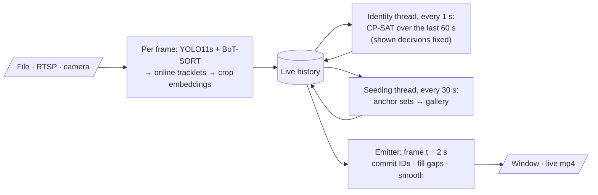

# Padel Player Re-ID & Tracking

Keeps **Player 1–4** identities stable through crossings, occlusions, players leaving the frame, and changeovers in a padel match filmed by a static camera.

- **How it works:** a detector and tracker produce short, *pure* tracklets. A person Re-ID model matches each tracklet against a per-player gallery that the pipeline seeds itself from moments where all 4 players are cleanly visible. A CP-SAT global assignment then fuses appearance, court side / team, the re-link gate and exclusivity.
- **No labels needed in production:** inference reads no manual labels and runs on any match or frame range. Hand labels are used only for evaluation.
- **Live mode:** processes a file, RTSP/HTTP stream or camera frame by frame and shows the IDs 2 seconds behind the input, with the same accuracy as the offline pipeline ([Live mode](#live-mode)).
- **Full write-up:** [docs/technical_report.md](docs/technical_report.md).
- **Demo video:** [Watch the output video with Player 1–4 IDs](https://drive.google.com/file/d/1ORy2fCMEpy_zoHTpdT7dqxvILK9tx2F3/view?usp=sharing).

## Pipeline at a glance


Stage 1 (detect to tracklets) is deliberately conservative. It cuts a track whenever two players come close, so no ID is ever carried through a crossing. Stage 2 then decides *who* each tracklet is, using the whole match.

## Setup

```bash
# Python 3.11, NVIDIA GPU recommended
pip install torch torchvision --index-url https://download.pytorch.org/whl/cu124   # pick your CUDA
pip install -r requirements.txt

# Re-ID weights: OSNet-AIN x1.0 trained on MSMT17 (torchreid model zoo)
python -c "import gdown; gdown.download('https://drive.google.com/uc?id=1SigwBE6mPdqiJMqhuIY4aqC7--5CsMal', 'weights/osnet_ain_x1_0_msmt17.pth')"
```

Put the match video at `Data/game-24412_77-107min.mp4`, or change `video_path` in [config/default.yaml](config/default.yaml). YOLO11 weights download automatically.

## How to run

All commands run from the project root (the folder containing `padel_reid/`).

### 1. Check the inputs are in place

```
Data/game-24412_77-107min.mp4        the match video
weights/osnet_ain_x1_0_msmt17.pth    Re-ID weights (Setup step above)
config/court.yaml                    court calibration for this camera (already provided)
```

### 2. Run the whole pipeline

```bash
python -m padel_reid run
```

That single command runs every step in order. No labels or manual input are needed:

| Step | What it does | Output | Time on an RTX 3050 Laptop (30-min video) |
|---|---|---|---|
| 1. detect | Court mask → YOLO11s → BoT-SORT | `cache/detections.parquet` | ~7 min |
| 2. tracklets | Cut tracks at interactions into pure tracklets | `cache/tracklets.parquet` | seconds |
| 3. embed | OSNet-AIN + colour + quality per crop | `cache/embeddings.npz` | ~5 min |
| 4. assign | Self-seed the gallery, then CP-SAT identity assignment | `cache/assigned_detections.parquet`, `cache/identity_events.json` | seconds |
| 5. render | Draw Player 1–4 boxes, status panel and mini-map | **`outputs/padel_player_ids.mp4`** | ~17 min |

When it finishes:
- **The output video** is `outputs/padel_player_ids.mp4`.
- **The per-frame IDs** are in `cache/assigned_detections.parquet`.
- **Changeovers, exits/re-entries and seeding details** are in `cache/identity_events.json`.

### 3. (Optional) Analysis, metrics and charts

```bash
python -m padel_reid analyze     # why IDs switch in this video   -> outputs/analysis/
python -m padel_reid baselines   # comparison methods             -> cache/baseline_*.parquet
python -m padel_reid heldout     # IDSW / IDF1 / MOTA / HOTA      -> outputs/metrics/heldout_identity.csv
python -m padel_reid charts      # README / report figures        -> docs/images/
```

### Run all three videos

Each clip has its own court calibration, so pass the matching `court_config` and give every run its own cache and output folder:

```bash
# Data/court2.mp4 (1920x1080, pillarboxed portrait clip)
python -m padel_reid run --set video_path=Data/court2.mp4 court_config=config/court.yaml cache_dir=cache_court2 output_dir=outputs_court2

# Data/court3.mp4 (3840x2160, ~14 fps)
python -m padel_reid run --set video_path=Data/court3.mp4 court_config=config/court_court3.yaml cache_dir=cache_court3 output_dir=outputs_court3

# Data/game-24412_77-107min.mp4 (1920x1080, 30-min match)
python -m padel_reid run --set video_path=Data/game-24412_77-107min.mp4 court_config=config/court_game-24412.yaml cache_dir=cache_game-24412 output_dir=outputs_game-24412
```

Each output video is `<output_dir>/padel_player_ids.mp4`.

Live mode takes the same settings. It plays each file frame by frame with the 2-second display delay and writes `<output_dir>/padel_player_ids_live.mp4`:

```bash
# Data/court2.mp4
python -m padel_reid live --set video_path=Data/court2.mp4 court_config=config/court.yaml cache_dir=cache_court2_live output_dir=outputs_court2_live

# Data/court3.mp4
python -m padel_reid live --set video_path=Data/court3.mp4 court_config=config/court_court3.yaml cache_dir=cache_court3_live output_dir=outputs_court3_live

# Data/game-24412_77-107min.mp4
python -m padel_reid live --set video_path=Data/game-24412_77-107min.mp4 court_config=config/court_game-24412.yaml cache_dir=cache_game-24412_live output_dir=outputs_game-24412_live
```

Add `live.realtime_playback=false` to process a file as fast as possible instead of at video speed, or `live.display=false` to run without the preview window.

### Common variations

```bash
# Only part of the video (frames 21000-22800 = 11:40-12:40), e.g. for a quick test
python -m padel_reid run --set start_frame=21000 end_frame=22800 cache_dir=cache_test output_dir=outputs_test

# A different video from the same camera: use a fresh cache folder
python -m padel_reid run --set video_path=Data/other_match.mp4 cache_dir=cache_other output_dir=outputs_other

# Re-render only part of the result
python -m padel_reid render --start 27600 --end 28950 --output changeover.mp4

# Live, frame by frame, with a 2-second display delay
python -m padel_reid live
```

### Things to know
- **`run` reuses cached detections.** If `cache/detections.parquet` exists, step 1 is skipped. After changing detection settings or the video, delete `cache/` or pass a new `cache_dir`, as in the examples above.
- **A different camera needs new court calibration.** `config/court.yaml` holds court landmarks for this camera. Another installation needs its own landmarks: 9 points, described in the file.
- **Any config value can be overridden** with `--set key=value`, e.g. `--set detection.batch_size=4` on a GPU with less memory.
- **Without an NVIDIA GPU** it still runs, but much more slowly.

## All stages (reference)

Every stage reads and writes `cache/`, so stages can be re-run on their own. Use `--set start_frame=... end_frame=...` to work on a part of the video.

```bash
# Production: everything below in one command, no labels needed
python -m padel_reid run

# or stage by stage
python -m padel_reid detect                     # pass 1: YOLO11s @960 + BoT-SORT          -> cache/detections.parquet
python -m padel_reid tracklets                  # cut tracks at interactions              -> cache/tracklets.parquet
python -m padel_reid embed                      # OSNet-AIN MSMT17 embeddings             -> cache/embeddings.npz
python -m padel_reid assign                     # self-seeding + global CP-SAT assignment -> cache/assigned_detections.parquet
python -m padel_reid render                     # outputs/padel_player_ids.mp4

# Analysis and evaluation (the only steps that use hand labels)
python -m padel_reid analyze                    # outputs/analysis/ (why IDs switch: plots + summary.json)
python -m padel_reid baselines                  # position-lock baseline, ByteTrack, ablation, label-seeded oracle
python -m padel_reid heldout                    # identity accuracy on the held-out and seed ground truth
python -m padel_reid charts                     # docs/images/*.png used in this README and the report
```

`cache/identity_events.json` reports how the gallery was seeded (`seeding`: anchor sets found and accepted, seed tracklets per player).

**Adding evaluation labels.** `python -m padel_reid label` writes contact sheets to `cache/thumbnails/` and a template `evaluation_data/new_tracklet_labels.yaml`. Fill in the labels, then run `python -m padel_reid freeze --gt evaluation_data/<name>_ground_truth.csv` to turn them into box-level ground truth. Tracklet ids are only valid for one detection run; frozen boxes are not.

## Live mode

`live` processes every frame once, as it arrives, and shows Player 1–4 boxes in a window about 2 seconds behind the input:

```bash
python -m padel_reid live                                  # the configured video, played as if live
python -m padel_reid live --source rtsp://camera/stream    # an RTSP/HTTP stream
python -m padel_reid live --source 0                       # a local camera
python -m padel_reid live --set live.playback_speed=2                             # a file at 2x speed, no frames dropped
python -m padel_reid live --set live.realtime_playback=false live.display=false   # a file, as fast as possible
python -m padel_reid refine                                # optional, after the match: whole-match assignment
```



- **One decode per frame.** Detection, tracking, tracklet cutting and Re-ID embedding all run on the frame while it is in memory. The online tracklet builder reproduces the batch tracklets exactly (same 717 tracklets on this match).
- **Identity every second.** The same CP-SAT assignment runs over a sliding 60-second window. Tracklets and team sides already shown on screen are fixed, so **an ID never changes after it has been displayed**. A solve only sees frames whose Re-ID crops are already embedded, so no tracklet is labelled from its court side alone.
- **Gallery every 30 s.** A separate thread re-derives the gallery from the anchor sets of the whole session, so a slow reseed never delays a solve.
- **Why a 2-second delay.** It lets the solver see a crossing end before showing it, and lets the emitter fill short gaps and smooth boxes exactly as the offline pipeline does. It's also the shortest delay that's error-free on this match: with 0.5 s the changeover is missed, and with 1 s some boxes get a wrong ID right after it (sweep in [§8.5](docs/technical_report.md#85-live-mode-evaluation)).
- **Start-up.** Players are numbered by court region as soon as they are in clear view: near-left = Player 1, near-right = Player 2, far-left = Player 3, far-right = Player 4. A player who arrives later takes the free number of their region, but only while every numbered player of the team on that half is visible too. Otherwise the box could be a numbered player whose track broke, and appearance decides. Until a box is numbered it shows "?". Set `live.region_numbering=false` to wait for all four in clear view, as before.
- **Window.** Top right shows the displayed frame rate and the delay behind the input. **q** or **Esc** closes the window at once and saves the session; closing the program any other way can leave a broken mp4.
- **Cameras and real-time files.** When processing falls behind, the oldest frames are dropped (`live.camera_queue_frames`), so the delay stays bounded. Dropped frames fragment tracks; a busy machine can drop several percent. A file at `live.playback_speed` other than 1 never drops frames: it just plays slower if it can't keep up.
- **Outputs.** `outputs/padel_player_ids_live.mp4`, `cache/assigned_live.parquet` (exactly what was shown), `cache/identity_events_live.json` (seeding, changeovers, latency), and the same cache files as the offline stages. So `refine`, `heldout` and `baselines` work on a live session without decoding the video again. A live run writes to `cache_dir`, so point it at another folder (`--set cache_dir=cache_live`) to keep an offline cache.

**Live results on the full 30-minute match** (RTX 3050 Laptop; same hand-labelled ground truth as below):

| | Held-out accuracy | ID switches | IDF1 | HOTA | Seed-set accuracy |
|---|---|---|---|---|---|
| **Live, 2 s delay** (exactly what was shown) | **99.8%** | **0** | **0.999** | **0.928** | 99.3% |
| Live + `refine` after the match | 99.8% | 0 | 0.999 | 0.927 | 100% |
| Offline whole-video pipeline | 99.8% | 0 | 0.999 | 0.927 | 100% |

- The changeover at 15:40 is found live (committed at 15:45, the end of that 5-second side window).
- In every row accuracy equals coverage: no hand-labelled box gets a wrong ID, and no tracklet ever changed its ID on screen (0 of 711). An appearance check over the whole match still finds the two look-alike partners (Players 3 and 4) disagreeing on 0.4% of their frames live (0.2% offline).
- **The only live-only gap is start-up.** Players are numbered at the first moment all four are clearly visible (8.1 s into this match); before that, boxes show "?". After the first 30 s, live and offline score the same: overall 99.9%, first 2 s after a re-entry 100%. Around crossings and close play (99.6%) and at the changeover (100%) they are equal throughout. Full breakdown: [technical report §8.5](docs/technical_report.md#85-live-mode-evaluation).
- **Speed.** A file runs at **57 FPS** as fast as possible (1.9× real time). Played at its own 30 fps, the display delay is **2.0 s (p50) / 2.4 s (p95)** with 0.1% of frames dropped. An HTTP stream and a USB camera were tested the same way. (Speed was measured before the two latest fixes, which add waiting inside the 2 s delay, not computation; the evaluated run itself was played with the window open at `playback_speed=2`.)


### Results on this video

**Required metrics**, for the proposed pipeline on the full 30-minute match:

| Metric | Result |
|---|---|
| ID switches (IDSW) | **0** |
| IDF1 | **0.999** |
| MOTA | 0.998 *(optimistic: see note)* |
| HOTA | **0.928** |
| FPS | **135.9** detection + tracking · **76.5** end to end (RTX 3050 Laptop GPU) |
| Correctly maintained identities | **4 / 4** (99.8% identity accuracy) |

These are measured on 40 hand-labelled held-out tracklets (40,558 boxes). The pipeline uses no labels, so these are unseen:
- IDSW, IDF1 and identities maintained are reliable.
- MOTA is optimistic, because the ground-truth boxes come from our detector, so missed people cannot count as errors.
- Definitive MOTA and HOTA on the hardest moments come from the four CVAT clips once they are corrected (see [Evaluation](#evaluation)).

Comparison with the baselines on the same tracklets:


| Method | Identity accuracy | ID switches | IDF1 | HOTA | Identities maintained |
|---|---|---|---|---|---|
| BoT-SORT raw | 17.8% | 49 | 0.178 | 0.335 | 0 / 4 |
| Position lock (Baek & Yun-style) | 54.1% | 14 | 0.542 | 0.502 | 0 / 4 |
| **Ours (proposed, label-free)** | **99.8%** | **0** | **0.999** | **0.928** | **4 / 4** |
| Label-seeded oracle (40 hand labels, upper bound) | 99.8% | 0 | 0.999 | 0.928 | 4 / 4 |

The remaining 0.2% are boxes with no matching prediction in those frames, not wrong IDs. The label-free pipeline matches the label-seeded oracle exactly. On a second set of 40 hand-labelled tracklets (`evaluation_data/seed_ground_truth.csv`), it reaches 100% identity accuracy with 0 ID switches.

The teams change ends at 15:40. The assignment finds this by itself and keeps every player's ID through it:


On an RTX 3050 Laptop GPU, detection and tracking run at **136 FPS**, and the whole pipeline (detection, tracking, Re-ID, identity assignment) at **76 FPS**: the 30-minute match takes under 12 minutes. See [docs/technical_report.md](docs/technical_report.md) for details. Regenerate all charts with `python -m padel_reid charts`.

### Evaluation

1. Export hard clips with a pre-annotation. Four clips are already chosen (far-side crossings, the changeover, an exit/re-entry); see [docs/ground_truth_annotation.md](docs/ground_truth_annotation.md).

   ```bash
   python -m padel_reid gtclip --start 7650 --end 9150 --output far_crossing_0415
   ```

2. In CVAT, upload `clip.mp4` and import `annotations_for_cvat.zip` (MOT 1.1 format). Correct every box and ID, then export as MOT 1.1 and replace `gt/gt.txt`. The step-by-step guide and player descriptions are in [docs/ground_truth_annotation.md](docs/ground_truth_annotation.md).

3. Run the baselines and ablations, then evaluate every method on the clip:

   ```bash
   python -m padel_reid baselines
   python -m padel_reid evaluate --gt outputs/gt_clips/far_crossing_0415/gt/gt.txt
   ```

   This reports HOTA, MOTA, IDF1, IDSW, FP, FN and identities maintained. Results are written to `outputs/metrics/`, together with the per-stage FPS from `cache/stage_timing.json`.

## Layout

```
padel_reid/
  api.py                    public entry point (one function per stage)
  cli.py                    `python -m padel_reid <stage>`
  common/                   config loading, video I/O, cache paths, stage timing
  court/                    fisheye-corrected homography, pre-detection court mask, court side / ROI
  detection/                YOLO11 person detection + BoT-SORT
  tracking/                 interaction detection, pure tracklets
  reid/                     OSNet-AIN embedder, colour descriptor, crop quality
  identity/                 anchor-set self-seeding, player gallery, re-link gate, exit/re-entry, CP-SAT assignment
  baselines/                Baek & Yun position-lock tracker, baseline runner
  rendering/                frame overlay (boxes, status panel, mini-map) and the offline renderer
  live/                     live mode: frame sources, online tracklets, sliding-window identity, emitter
  evaluation/               MOT metrics (CLEAR, IDF1, HOTA), ground-truth clips, tracklet annotation, report
  analysis/                 video analysis plots, README/report charts
config/                     pipeline, tracker and court calibration settings (no labels)
evaluation_data/            hand labels and frozen ground truth (evaluation only)
```

## Credits

- **OSNet-AIN architecture:** vendored from [deep-person-reid](https://github.com/KaiyangZhou/deep-person-reid) (MIT).
- **Gap re-linking and the position-lock baseline:** adapted from Baek & Yun, *Bridging the gap: Doubles badminton analysis with singles-trained models* (2026). No code was copied, because that repository has no license.
