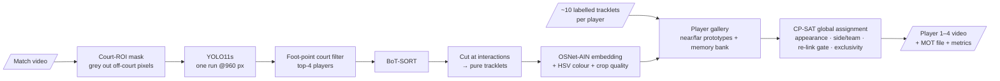

# Padel Player Re-ID & Tracking

Keeps **Player 1–4** identities stable through crossings, occlusions, players leaving the frame, and changeovers in a padel match filmed by a static camera.

- **How it works:** a detector and tracker produce short, *pure* tracklets. A person Re-ID model matches each tracklet against a per-player gallery seeded from a few labelled tracklets. A CP-SAT global assignment then fuses appearance, court side / team, the re-link gate and exclusivity.
- **Full write-up:** [docs/technical_report.md](docs/technical_report.md).
- **Demo video:** [Watch the output video with Player 1–4 IDs](https://drive.google.com/file/d/1ORy2fCMEpy_zoHTpdT7dqxvILK9tx2F3/view?usp=sharing).

## Pipeline at a glance



Stage 1 (detect to tracklets) is deliberately conservative. It cuts a track whenever two players come close, so no ID is ever carried through a crossing. Stage 2 then decides *who* each tracklet is, using the whole match.

## Setup

```bash
# Python 3.11, NVIDIA GPU recommended
pip install torch torchvision --index-url https://download.pytorch.org/whl/cu124   # pick your CUDA
pip install -r requirements.txt

# Re-ID weights: OSNet-AIN x1.0 trained on MSMT17 (torchreid model zoo)
python -c "import gdown; gdown.download('https://drive.google.com/uc?id=1SigwBE6mPdqiJMqhuIY4aqC7--5CsMal', 'weights/osnet_ain_x1_0_msmt17.pth')"
```

Put the match video at `Data/game-24412_77-107min.mp4`, or change `video_path` in [config/default.yaml](config/default.yaml). YOLO11 weights download automatically.

## Reproduce

Every stage reads and writes `cache/`, so stages can be re-run on their own. Use `--set start_frame=... end_frame=...` to work on a part of the video.

```bash
python -m padel_reid detect                     # pass 1: YOLO11s @960 + BoT-SORT          -> cache/detections.parquet
python -m padel_reid tracklets                  # cut tracks at interactions              -> cache/tracklets.parquet
python -m padel_reid embed                      # OSNet-AIN MSMT17 embeddings             -> cache/embeddings.npz
python -m padel_reid label                      # contact sheets in cache/thumbnails/
#   config/tracklet_labels.yaml already holds the 40 gallery seeds for this video
#   (tracklet ids are only valid for the cached tracklets; relabel after re-running detection)
python -m padel_reid assign                     # global CP-SAT assignment -> cache/assigned_detections.parquet
python -m padel_reid render                     # outputs/padel_player_ids.mp4
python -m padel_reid analyze                    # outputs/analysis/ (why IDs switch: plots + summary.json)
python -m padel_reid baselines                  # position-lock baseline, ByteTrack, ablation
python -m padel_reid heldout                    # identity accuracy on held-out hand-labelled tracklets
python -m padel_reid charts                     # docs/images/*.png used in this README and the report
```


### Results on this video

**Required metrics**, for the proposed pipeline on the full 30-minute match:

| Metric | Result |
|---|---|
| ID switches (IDSW) | **0** |
| IDF1 | **0.999** |
| MOTA | 0.998 *(optimistic: see note)* |
| HOTA | **0.928** |
| FPS | **135.9** detection + tracking · **76.5** end to end (RTX 3050 Laptop GPU) |
| Correctly maintained identities | **4 / 4** (99.8% identity accuracy) |

These are measured on 40 hand-labelled held-out tracklets (40,558 boxes) that were not used as gallery seeds:
- IDSW, IDF1 and identities maintained are reliable.
- MOTA is optimistic, because the ground-truth boxes come from our detector, so missed people cannot count as errors.
- Definitive MOTA and HOTA on the hardest moments come from the four CVAT clips once they are corrected (see [Evaluation](#evaluation)).

Comparison with the baselines on the same tracklets:


| Method | Identity accuracy | ID switches | IDF1 | HOTA | Identities maintained |
|---|---|---|---|---|---|
| BoT-SORT raw | 17.8% | 49 | 0.178 | 0.335 | 0 / 4 |
| Position lock (Baek & Yun-style) | 54.1% | 14 | 0.542 | 0.502 | 0 / 4 |
| **Ours (proposed)** | **99.8%** | **0** | **0.999** | **0.928** | **4 / 4** |

The remaining 0.2% are boxes the detector did not produce in those frames, not wrong IDs.

The teams change ends at 15:40. The assignment finds this by itself and keeps every player's ID through it:


On an RTX 3050 Laptop GPU, detection and tracking run at **136 FPS**, and the whole pipeline (detection, tracking, Re-ID, identity assignment) at **76 FPS**: the 30-minute match takes under 12 minutes. See [docs/technical_report.md](docs/technical_report.md) for details. Regenerate all charts with `python -m padel_reid charts`.

### Evaluation

1. Export hard clips with a pre-annotation. Four clips are already chosen (far-side crossings, the changeover, an exit/re-entry); see [docs/ground_truth_annotation.md](docs/ground_truth_annotation.md).

   ```bash
   python -m padel_reid gtclip --start 7650 --end 9150 --output far_crossing_0415
   ```

2. In CVAT, upload `clip.mp4` and import `annotations_for_cvat.zip` (MOT 1.1 format). Correct every box and ID, then export as MOT 1.1 and replace `gt/gt.txt`. The step-by-step guide and player descriptions are in [docs/ground_truth_annotation.md](docs/ground_truth_annotation.md).

3. Run the baselines and ablations, then evaluate every method on the clip:

   ```bash
   python -m padel_reid baselines
   python -m padel_reid evaluate --gt outputs/gt_clips/far_crossing_0415/gt/gt.txt
   ```

   This reports HOTA, MOTA, IDF1, IDSW, FP, FN and identities maintained. Results are written to `outputs/metrics/`, together with the per-stage FPS from `cache/stage_timing.json`.

## Layout

```
padel_reid/
  api.py                    public entry point (one function per stage)
  cli.py                    `python -m padel_reid <stage>`
  common/                   config loading, video I/O, cache paths, stage timing
  court/                    fisheye-corrected homography, pre-detection court mask, court side / ROI
  detection/                YOLO11 person detection + BoT-SORT
  tracking/                 interaction detection, pure tracklets
  reid/                     OSNet-AIN embedder, colour descriptor, crop quality, labelling
  identity/                 player gallery, re-link gate, exit/re-entry, CP-SAT assignment
  baselines/                Baek & Yun position-lock tracker, baseline runner
  rendering/                output video with status panel and mini-map
  evaluation/               MOT metrics (CLEAR, IDF1, HOTA), ground-truth clips, report
  analysis/                 video analysis plots, README/report charts
config/                     pipeline, tracker and court calibration settings
```

## Credits

- **OSNet-AIN architecture:** vendored from [deep-person-reid](https://github.com/KaiyangZhou/deep-person-reid) (MIT).
- **Gap re-linking and the position-lock baseline:** adapted from Baek & Yun, *Bridging the gap: Doubles badminton analysis with singles-trained models* (2026). No code was copied, because that repository has no license.
