# Padel Player Re-ID & Tracking — Technical Report

## 1. Current problem

The input is a 30-minute padel match (`game-24412_77-107min.mp4`, 1920×1080, 30 fps). It is filmed by one static, elevated fisheye camera behind the near baseline.

Generic trackers such as ByteTrack and BoT-SORT associate detections frame to frame using box overlap (IoU) and a Kalman motion model. That breaks down here for five reasons:

| Situation in this video | Why the tracker swaps or loses IDs |
|---|---|
| **Crossing / overlap**: partners cross while covering the court, and far players overlap in depth | When boxes merge, IoU and constant-velocity motion are ambiguous. The tracker picks the wrong continuation. |
| **Occlusion**: a far player hidden behind their partner for several frames | The track is lost. On reappearance it gets a new ID, or steals the partner's. |
| **Similar clothing**: two players in black, two in grey | Generic Re-ID features (trained on street pedestrians) separate them poorly, especially on small, blurry far-side crops. |
| **Motion blur / low resolution**: far players are ~120 px tall and blurred | Weak detections and unstable boxes lead to fragmentation. |
| **Leaving the frame**: the bottom of the image cuts around the near service line, so near players often step out of view; players also leave to fetch balls | The track ends. A new ID is born on return. |
| **Changeovers**: teams switch ends during the match | Any approach that ties identity to court position (e.g. "back-left = Player 1") swaps every player at every changeover. |
| **Neighbouring court**: players on the next court are visible through the glass | They are detected as people and compete for IDs. |

The numbers behind these statements are in Section 8: gap-length distribution, interactions per minute, exits and re-entries, and changeovers.

## 2. Key idea: a closed-set problem

The camera never moves, and there are **always the same four people**. So the task is reformulated: not "track an unknown number of objects", but "for each detection, decide which of 4 known identities it is". Four independent cues are fused:

1. **Appearance**: a person Re-ID model plus a colour descriptor, matched against a per-player gallery that the pipeline seeds itself, with no manual labels (Section 4.1).
2. **Court geometry**: a lens-distortion-corrected homography maps feet to court metres. During play, a player never crosses the net.
3. **Team constraint**: partners are always on the same half. At a changeover the *pair* switches together.
4. **Exclusivity**: each identity appears at most once per frame.

## 3. Proposed architecture

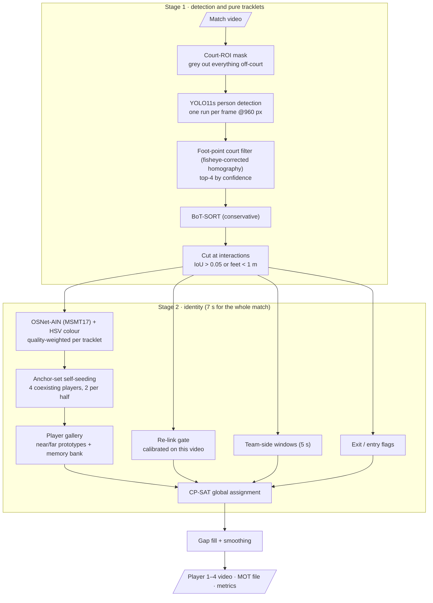

### 3.1 Detection

`padel_reid/detection/player_detector.py`

- **One YOLO11s run per frame at 960 px.** The input size was chosen by measuring how often *both* small far-side players are found, on 300 frames sampled across the match:

  | Detector setup | ms / frame | Both far players found |
  |---|---|---|
  | YOLO11s, one run @640 | 10.3 | 94.0% |
  | **YOLO11s, one run @960 (chosen)** | **12.9** | **97.0%** |
  | YOLO11s, full frame @640 + far-court crop (two runs) | 12.7 | 97.0% |
  | YOLO11s, one run @1280 | 20.2 | 97.3% |
  | YOLO11m, one run @960 | 21.6 | 97.7% |

  - A separate far-court crop gave no extra recall over a single run at 960, so the simpler single run is used.
  - Larger inputs or models add under 1 point of recall at about 1.6× the cost.
  - A pose model (YOLO11m-pose) was tried for ankle keypoints and dropped: it missed most far players.
- **Partial duplicates.** A box lying more than 80% inside a bigger box (e.g. upper body only) is dropped, because plain NMS keeps such boxes.
- **Court geometry.** The lens has strong barrel distortion: the straight near service line bows by ~120 px. A single radial coefficient k1 is fitted jointly with the homography from court landmarks (`court/homography.py`). Landmark reprojection error is ~0.1 m, versus ~1 m without the distortion term.
- **Court ROI, applied in two places** (`court/court_roi_mask.py`, `court/court_side.py`):
  1. **Before YOLO.** A mask is built once from the fisheye-corrected mapping. It covers the court plus 1.5 m, extended upward in each column by the height a standing player has at that image row. A fitted height model (0.40 × foot row − 45 px) with 15% headroom is applied from 0.3 m beyond the glass walls. Each frame is cropped to the mask's bounding box and everything outside is painted grey before detection.
     - On 300 sampled frames, this removes **73% of the people YOLO finds outside the court** (551 → 146 boxes).
     - Far-player recall is unchanged (96.7%), and the mask costs 1.6 ms per frame.
  2. **After YOLO.** Boxes whose foot point maps outside the court plus 1.5 m are dropped, then the 4 most confident are kept. This is still needed: seen through the side glass, the neighbouring court occupies the same pixels as our own players standing near the side walls, so no image mask can remove it completely without cutting those players off.

### 3.2 Tracking: short, pure tracklets

`tracking/tracklet_builder.py`, `tracking/interaction_detector.py`

- Ultralytics **BoT-SORT**, tuned conservatively, with camera-motion compensation off because the camera is static.
- **The tracker does not decide identity.** Every raw track is **cut** whenever it enters or leaves an *interaction*: boxes overlap (IoU > 0.05) or feet are less than 1 m apart (padded by 3 frames). Tracks are also cut after long tracker-bridged gaps.
- Each resulting tracklet very likely contains a single person. A wrong cut costs nothing, because the assignment stage reconnects it. A wrong *merge* is exactly the ID switch we want to avoid.

## 4. Re-ID methodology

### 4.1 Appearance model

`reid/embedding_model.py`, `identity/anchor_seeding.py`

- **Backbone:** OSNet-AIN x1.0 with MSMT17 person Re-ID weights, used **as is** (no training on this match). It is light (2.2 M parameters), and instance normalisation makes it robust to lighting and domain change.
- **Label-free gallery seeds instead of training** (`identity/anchor_seeding.py`). Inference reads no manual labels, so it runs on any new match or frame range. The scene structure replaces the labels:
  - An **anchor set** is a moment where 4 clean, long tracklets coexist, 2 on each half. Coexisting tracklets are different people and partners share a half, so such a set is a fully separated sample of all 4 players with the team split known. Only 8 mappings of a set to Players {1, 2 | 3, 4} respect the teams.
  - The best anchor set fixes the numbering: team A is its near pair, and the lower `court_x` gets the lower number inside a team. This is the only source of hard labels for the solver, and it only breaks the player-permutation symmetry.
  - The other sets are accepted confident-first: each time, the set whose best team-consistent mapping beats the runner-up by the largest margin, matched against a gallery grown from the sets accepted so far. A set sharing a tracklet with an accepted one must agree with it. A soft side-continuity term keeps teams on the halves of nearby sets unless appearance clearly says otherwise (changeovers).
  - A leave-one-set-out refinement then re-picks every set against a gallery built from all the others and votes per tracklet.
  - On the full match: 91 anchor sets found and accepted (74 fully determined by shared tracklets), 144 seed tracklets. All 44 seed tracklets that overlap the hand-labelled evaluation data are correct.
  - Seeds only feed the gallery; the solver can overrule them, and seeds it overrules are dropped before round 2.
  - **Fallbacks** for short clips or breaks: 3-player sets, then 2-player sets, then k-means clustering. Players that no set covers stay unlabelled rather than being guessed.
  - Hand labels are now used **only for evaluation** (`evaluation/tracklet_annotation.py`, `evaluation/tracklet_label_freezer.py`), and for a label-seeded *oracle* run kept as an upper bound.
- **Colour descriptor** (`reid/color_descriptor.py`): HSV histograms of head, upper body and legs, with court-blue pixels masked out. It is robust to blur, separates a cap from a bald head or white hair, and is fused with weight 0.2.
- **Crop quality** (`reid/crop_quality.py`): size × detector confidence × (1 − overlap) × sharpness (Laplacian variance), halved when the box is cut off by the frame. Every average is quality-weighted, so blurred, occluded or truncated crops barely count.

### 4.2 What a new tracklet is matched against

`identity/player_gallery.py`, `identity/tracklet_descriptors.py`

A crop is **never** compared with a single stored image:

- **Query:** the quality-weighted mean embedding of the tracklet's crops (~15 or more). Averaging cancels blur and odd poses.
- **Gallery per player:**
  - a **near-side and a far-side prototype**, because a player looks very different large and sharp versus small and blurry. This idea comes from the separate front-court and back-court models in Baek & Yun (2026).
  - a FIFO **memory bank** of the 100 most recent high-quality crop embeddings.
- **Score:** `0.5·cos(query, prototype[side]) + 0.5·max cos(query, bank)`, fused with colour similarity.
- The gallery grows only from confidently identified, isolated tracklets. It is never updated from crops taken during interactions or occlusions.

How one new tracklet is matched:

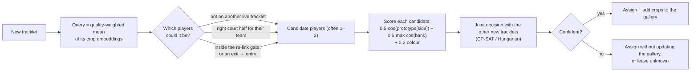

## 5. Association strategy

`identity/global_assignment.py`

Every tracklet gets exactly one of {Player 1–4, unknown}. OR-Tools CP-SAT minimises:

| Term | Meaning |
|---|---|
| appearance | (best log-prob − this player's log-prob) × evidence, where evidence is the tracklet's summed crop quality, capped at 10 s |
| side / team | One boolean per 5 s window says which half team A is on. Each frame a player spends on the "wrong" half costs a little. Flipping the boolean between windows costs a lot. |
| re-link bonus | Reward when a tracklet and one starting inside its calibrated re-link gate get the same player |
| unknown | Per-second cost of leaving a tracklet unlabelled (false positives) |

Subject to:

- **Exclusivity:** tracklets with boxes **in the same frame** never share a player (one clique per distinct set of co-present tracklets, `exclusivity_constraints`).
  - Time-span overlap alone is not used. When BoT-SORT flickers, the old and new track ids alternate for a few frames, so the two spans overlap without the boxes ever being in the same frame. If that counted as two people, the new tracklet could never get the player the old one already had. In live mode that left a 100-second far-side tracklet at 1:23–3:05 unlabelled.
  - Such interleaved pairs may share a player if the overlap is at most 10 frames and the handover position is reachable at the speed limit. On this match that frees 7 of 1,893 pairs.
- **Speed limit:** two tracklets cannot share a player if moving from the end of one to the start of the other would exceed 7 m/s.
- **Fixed labels:** the 4 tracklets of the reference anchor set keep their players. They fix the numbering, nothing else.

The solve runs in two rounds. Round 2 re-scores appearance with a gallery grown from round 1's most confident assignments (self-training).

## 6. How position switching is handled

- When partners cross, the boxes overlap. The tracklets are cut, so nothing carries a possibly wrong ID through the crossing.
- After the crossing, the two new tracklets are assigned *jointly*. Exclusivity leaves only the two players involved as candidates, and the team constraint keeps them on their half. Appearance then decides a 2-way question.
- A swap the tracker would have made therefore can't propagate. The decision is made on clean crops before and after the crossing, never on the merged box.

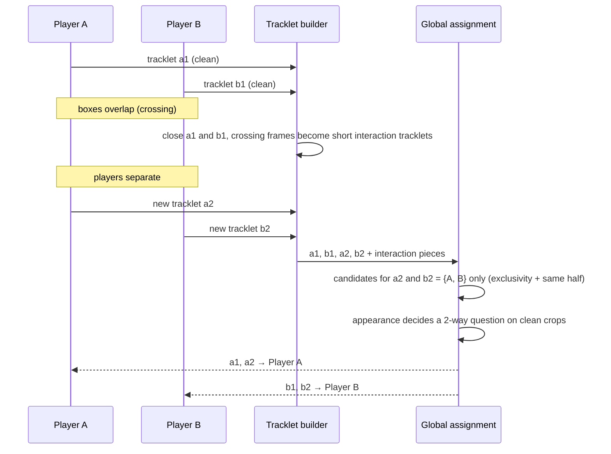
- **Changeovers:** the solver's per-window side boolean flips when the evidence says the teams have changed ends. No hand-tuned changeover detector is needed. The detected changeovers are reported (`identity/changeover_detector.py`).

## 7. How occlusion and leaving the frame are handled

- **Occlusion:** the hidden player's tracklet ends and a new one starts when they reappear.
  - **Predictive gap re-linking** (`identity/predictive_relinker.py`), adapted from Baek & Yun (2026): extrapolate at constant velocity, `S(t_s+t) = S(t_s) + v·t`, and accept candidates within a radius.
  - The radius is in **court metres**, **depends on the gap length**, and is **calibrated on this video**. Frames are deleted from clean tracklets and the 95th percentile of the prediction error is taken.
  - Motion is only a gate. Appearance chooses inside it.
  - Short gaps (≤ 1 s) are filled by interpolation, so the box stays on screen.
- **Leaving and re-entering the frame** (`identity/exit_reentry_handler.py`):
  - A tracklet ending at the frame border outside an interaction counts as an **exit**. One starting at the border counts as an **entry**.
  - While a player is out there is no time limit, the speed constraint is waived for exit→entry pairs, and the gallery is frozen.
  - On re-entry, exclusivity restricts candidates to the currently *absent* players. With one player out, that's a single choice that appearance only confirms. Low-similarity entries can remain unknown instead of stealing an ID.
  - The output video shows "Player k: out of frame".

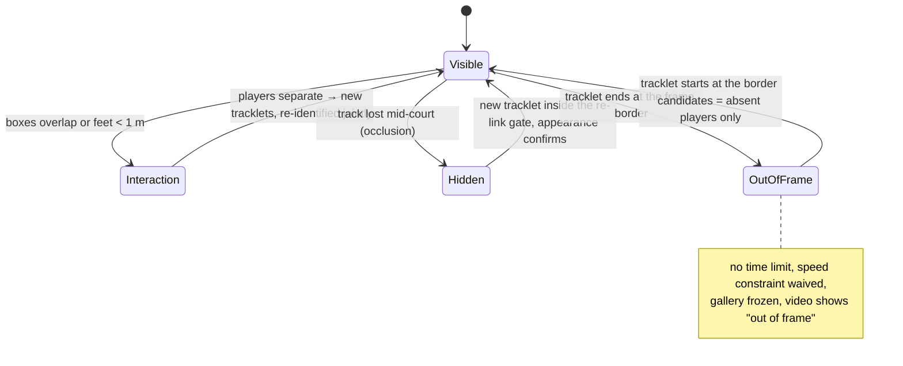

## 8. Results

### Required metrics at a glance

The metrics the assignment asks for, for the proposed pipeline on the full 30-minute match:

| Metric | Result | How it was measured | How far to trust it |
|---|---|---|---|
| **ID switches (IDSW)** | **0** (raw BoT-SORT: 49; Baek & Yun-style position lock: 14) | 40 hand-labelled held-out tracklets, 40,558 boxes, spread over the whole match (Section 8.2) | Valid |
| **IDF1** | **0.999** (raw BoT-SORT: 0.178; position lock: 0.542) | same held-out ground truth | Valid |
| **MOTA** | 0.998 | same held-out ground truth | **Optimistic:** the ground-truth boxes come from our detector, so missed people cannot count as errors (raw BoT-SORT also scores 0.994) |
| **HOTA** | **0.928** (AssA 0.928, DetA 0.927) | same held-out ground truth | Identity part (AssA) valid. The detection part is lowered by small box-size differences between the detector configuration used to make the ground truth and the final one. |
| **FPS / inference speed** | **135.9 FPS** detection + tracking; **76.5 FPS** end to end (30 min of video in 11.8 min) | full run on an RTX 3050 Laptop GPU (Section 8.3) | Measured |
| **Correctly maintained identities** | **4 / 4** (each player keeps one ID for ≥ 95% of their frames; 99.8% identity accuracy) | same held-out ground truth | Valid |

**What these numbers do and don't cover:**
- The held-out tracklets are long and clean. They show that identities survive the whole match, including the changeover at 15:40.
- They don't stress the hardest moments: short fragments during crossings and occlusions.

### 8.1 Video analysis

From `outputs/analysis/summary.json` (full 30-minute video):

| Measure | Value |
|---|---|
| Raw BoT-SORT IDs for 4 players | **563** distinct IDs |
| Pure tracklets after cutting at interactions | 717 (median 48 frames); 115 inside interactions |
| Interaction events (overlap or < 1 m apart) | 76 (2.5 per minute, median 0.3 s) |
| Detection gaps inside raw tracks | 427; 90% shorter than 10 frames (median 2) |
| Calibrated re-link gate (95th-pct prediction error) | 0.5 m @ 1 frame · 1.3 m @ 10 · 3.1 m @ 30 · 6.7 m @ 60 |
| Exit → re-entry events (player left the frame and came back) | 104 (median absence 1.4 s) |
| Changeovers found by the solver | 1, at 15:40 (team 3 & 4 to the near half), confirmed visually |
| Frames with all 4 players detected | 81% (most of the rest: a near player out of the bottom of the frame) |

**Why IDs switch:**
- The tracker fragments constantly: 563 IDs for 4 people, mostly because of short detection gaps and players leaving the frame.
- Close encounters happen about 2.5 times a minute.
- Identity therefore cannot come from the tracker. It has to come from Re-ID plus constraints.

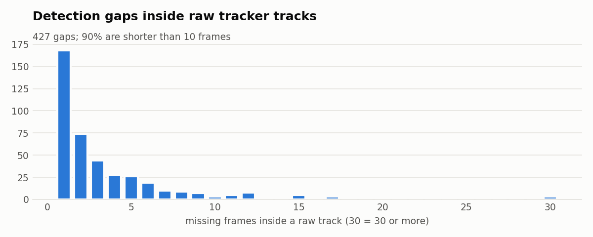

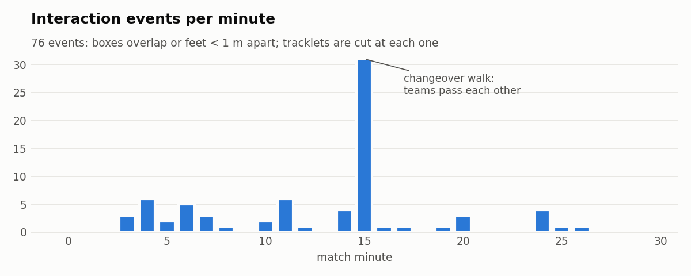

The spike at minute 15 is the changeover walk, when both teams pass each other on their way to the other end.

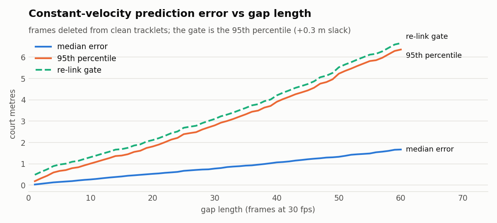

The median prediction error stays under 2 m even after 2 s. The 95th percentile, though, grows almost linearly to about 6.5 m. That is why the gate depends on gap length, and why motion alone (as in the Baek & Yun tracker) can't separate two players a few metres apart after a longer gap.

### 8.2 Identity accuracy on held-out tracklets

Two sets of 40 tracklets each were labelled by eye. They are spread over the whole match and cover both sides and both halves of the changeover. The pipeline itself uses no labels, so both sets are unseen:
- **held-out** (40,558 boxes, `evaluation_data/heldout_ground_truth.csv`);
- **seed** (39,866 boxes, `evaluation_data/seed_ground_truth.csv`): the tracklets that seeded the gallery in the earlier few-shot version. Only the label-seeded oracle has seen them, so it is left out on this set.
- The labelled tracklets are frozen as box-level ground truth, so the evaluation does not depend on tracklet ids and survives detection re-runs.
- Each method's IDs are mapped to the players with the best one-to-one mapping (`python -m padel_reid heldout`):

| Method | Held-out accuracy | Held-out ID switches | Seed accuracy | Seed ID switches | Distinct IDs |
|---|---|---|---|---|---|
| BoT-SORT raw (Ultralytics, motion + IoU) | 17.8% | 49 | 29.8% | 37 | 52 |
| Position lock (Baek & Yun-style re-implementation) | 54.1% | 14 | 51.0% | 10 | 4 |
| Ours without side/team cost (ablation) | 99.8% | 0 | 100% | 0 | 4 |
| **Ours (proposed, label-free)** | **99.8%** | **0** | **100%** | **0** | **4** |
| Label-seeded oracle (40 hand labels, upper bound) | 99.8% | 0 | n/a | n/a | 4 |

The label-free pipeline matches the label-seeded oracle exactly on the held-out set. On both sets accuracy equals coverage, so the missing boxes have no matching prediction in that frame; none carries a wrong identity.

The required MOT metrics on the same held-out GT, with predictions on unannotated players ignored:

| Method | IDSW ↓ | IDF1 ↑ | MOTA ↑ | HOTA ↑ | AssA ↑ | Identities maintained (≥95% of frames) |
|---|---|---|---|---|---|---|
| BoT-SORT raw | 49 | 0.178 | 0.994 | 0.335 | 0.119 | 0 / 4 |
| Position lock (Baek & Yun-style) | 14 | 0.542 | 0.995 | 0.502 | 0.268 | 0 / 4 |
| **Ours (proposed, label-free)** | **0** | **0.999** | **0.998** | **0.928** | **0.928** | **4 / 4** |

How to read these:
- IDSW, IDF1 and AssA are valid identity measures.
- MOTA is optimistic, because missed people can't appear in this GT.
- HOTA's detection part (DetA 0.927) is pulled down only by box geometry: the GT boxes come from an earlier detector configuration, and its boxes differ slightly in size from the final detector's, which matters at strict overlap thresholds.

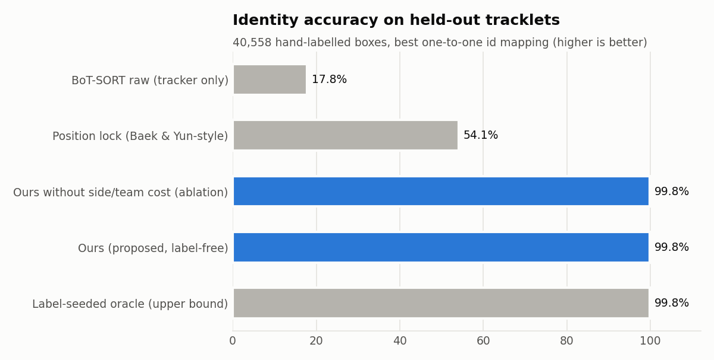

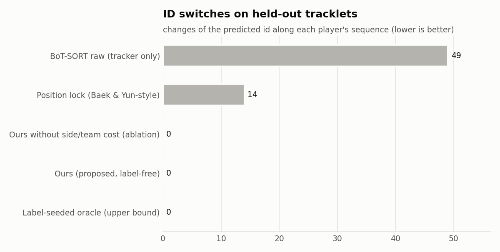

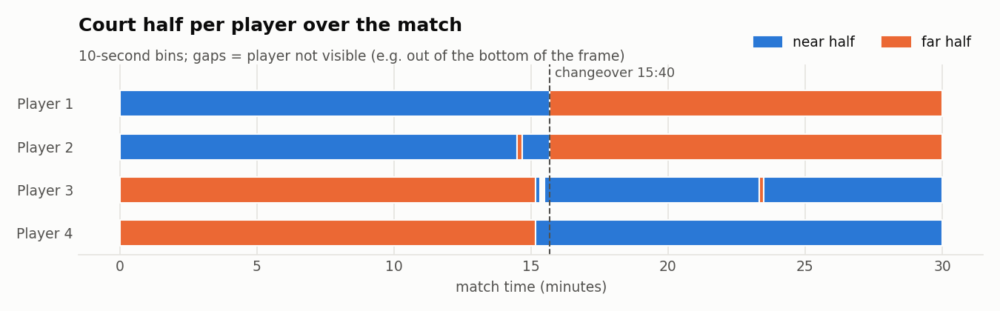

- The timeline shows the changeover the solver found at 15:40. Players 1 and 2 move from the near half to the far half, Players 3 and 4 the other way, and every ID survives it.
- The position lock collapses after the changeover, as predicted: identity equals court position.
- Our pipeline keeps all 4 identities with zero ID switches on every held-out tracklet, using **generic** Re-ID weights and **no labels**.
- These long, clean tracklets are the easier cases. The side/team term matters mainly for short and blurry tracklets around crossings.

### 8.3 Speed (RTX 3050 Laptop 6 GB, `cache/stage_timing.json`)

| Stage | Throughput |
|---|---|
| Detection + BoT-SORT (YOLO11s @960, court mask, GPU-batched) | **135.9 FPS** (54,000 frames in 6.6 min) |
| Tracklet building | ~7,700 frames/s |
| OSNet-AIN embedding (every 3rd frame of each tracklet) | 140 decoded frames/s (295 s for the match) |
| CP-SAT identity assignment (717 tracklets, 2 rounds) | 7 s for the whole match |
| **End-to-end** (excluding rendering) | **76.5 FPS**: the 30-minute match in 11.8 min |

How detection reaches this speed (`detection/gpu_batched_yolo.py`):
- **GPU pre-processing:** the court-ROI crop is uploaded once; masking, colour conversion, resizing and padding run on the GPU.
- **Multi-frame batches:** 8 frames per YOLO forward pass. The tracker still runs frame by frame, in order.
- **Person-only NMS:** non-maximum suppression runs on the person class only.

Re-ID embedding is the slowest stage per video frame.

### 8.4 Live mode (`padel_reid/live/`, `python -m padel_reid live`)

The stages above run one after another over the whole video. Live mode runs the same steps on each frame as it arrives, and shows frames **2 seconds late**:

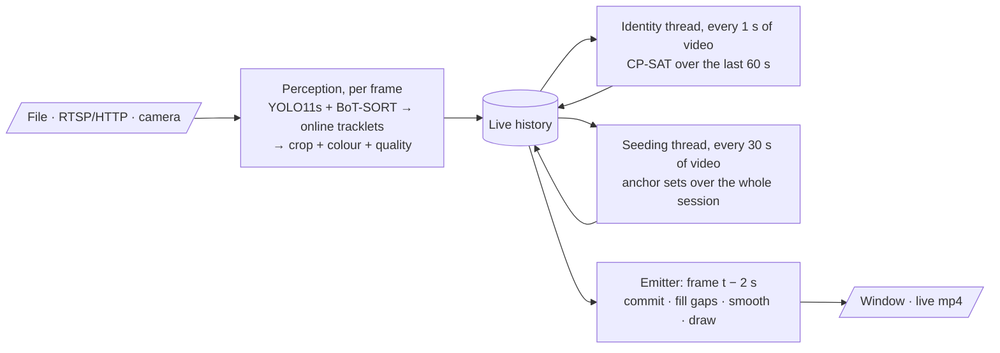

- **Online tracklets** (`live/online_tracklet_builder.py`): the interaction cut needs 3 frames of look-ahead. On this match it reproduces the batch builder exactly: the same 717 tracklets, interaction flags and overlaps.
- **Re-ID without a second decode** (`live/frame_embedder.py`): crops are cut while the frame is in memory. OSNet runs once 16 crops have queued up (or after 0.5 s), because each call has ~20 ms of fixed overhead.
- **Solves wait for embeddings** (`LiveHistory.snapshot`, `live_pipeline.py`): the identity frontier never moves past the oldest crop still waiting for its OSNet batch, and a solve sees no rows beyond the frontier.
  - Without this, a solve could see a new tracklet's court side before its appearance, and label it from the side alone.
  - That is wrong exactly during the changeover walk. In a real-time run with 7.8% dropped frames, it mixed the teams after 15:40. A replay of that run reproduced the failure with embeddings arriving 15 frames late, and the gating fixed it.
  - Cost: at most 0.5 s of extra waiting, hidden inside the 2 s delay.
- **Sliding-window identity** (`live/sliding_window_assigner.py`): the CP-SAT model of Section 5, over the tracklets of the last 60 s. Tracklets and team-side windows already shown are passed in as fixed (`fixed_labels`, `fixed_sides`). So **an ID never changes after it has been displayed**, and the window continues the committed side state.
- **Seeding while playing.** Players are numbered at the first moment with 4 clean players, 2 on each half; until then boxes show "?". Every 30 s, a separate thread re-runs the anchor-set seeding over the whole session, grown from that first reference set, and the gallery is rebuilt from the result.
  - A first version also fed the solver's own confident decisions into the gallery. On the full match that let one early mistake teach the gallery the wrong player: partners swapped for minutes, and at the changeover the solver relabelled players across teams instead of flipping sides. Held-out accuracy was 46%.
  - Deriving the gallery from anchor sets only fixed this.
- **The 2-second delay** (`live/frame_emitter.py`): a frame leaves the buffer only after a solve has seen at least 0.67 s past it (with embeddings, see above). Gap filling and box smoothing use the frames still in the buffer, so they give the same boxes as the offline post-processing (checked to 0.0 px).

### 8.5 Live-mode evaluation

**Setup.**
- **Run:** the full 30-minute match (54,000 frames) through `python -m padel_reid live` on an RTX 3050 Laptop.
- **What is scored:** `cache/assigned_live.parquet`, which holds exactly the boxes and IDs that were displayed (`ours_live` in `python -m padel_reid heldout`).
- **Ground truth:** the two hand-labelled sets of Section 8.2, 80 tracklets and 80,424 boxes, unseen by every method.
- **Not used:** the four CVAT clips (far-side crossings, changeover, near exit/crossing) are still uncorrected pre-annotations. The evaluation refuses to score the pipeline against its own output, so they are not used here.

**Overall** (`outputs/metrics/heldout_identity.csv`, `seed_identity.csv` of the live session):

| Method | Held-out accuracy | IDSW | IDF1 | HOTA | Seed-set accuracy | Seed IDSW | Identities kept (seed) |
|---|---|---|---|---|---|---|---|
| BoT-SORT raw (live session) | 17.8% | 49 | 0.178 | 0.335 | 29.8% | 37 | 0 / 4 |
| **Live, 2 s delay** (what was shown) | **99.8%** | **0** | **0.999** | **0.928** | 99.3% | **0** | **4 / 4** |
| Live session + `refine` after the match | 99.8% | 0 | 0.999 | 0.927 | 100% | 0 | 4 / 4 |
| Offline pipeline | 99.8% | 0 | 0.999 | 0.927 | 100% | 0 | 4 / 4 |

- **Same perception as offline.** The raw BoT-SORT row of the live session is identical to the offline one, and the online tracklet builder reproduces the 717 batch tracklets exactly. So every difference below comes from deciding identities without the future.
- **No wrong IDs on the ground truth.** In every row accuracy equals coverage: every missing point is a hand-labelled box shown without an ID, never with the wrong one.
- **No on-screen ID changes.** 0 of the 711 displayed tracklets ever showed two different IDs.
- **Player 3 vs 4.** The two grey-shirted partners are the hardest pair, and the hand-labelled sets do not cover every stretch of the match.
  - As an extra check, every team-B tracklet of the match was re-classified with side-specific P3/P4 prototypes built from all hand-labelled P3/P4 tracklets.
  - Live disagrees with that check on 0.4% of team-B frames, offline on 0.2%. Before the two fixes below, live disagreed on 1.4%; one replay with different reseed timing disagreed on 8.5%, swapping the partners for minutes at 19:14–19:44.

**Per scenario** (both GT sets together; `outputs/metrics/live_scenarios.csv`):

| Scenario | GT boxes | Live | Live + refine | Offline |
|---|---|---|---|---|
| All boxes | 80,424 | 99.5% | 99.9% | 99.9% |
| Within 1 s of an interaction (crossings, close play) | 2,498 | 99.6% | 99.6% | 99.6% |
| First 2 s after a player re-enters the frame | 7,548 | 97.9% | 100% | 100% |
| … the same, after the first 30 s | 7,277 | 100% | 100% | 100% |
| Changeover, 15:20–16:00 | 787 | 100% | 100% | 100% |
| Far half | 48,975 | 99.4% | 99.9% | 99.9% |
| Near half | 31,449 | 99.8% | 99.95% | 99.95% |
| First 30 s (start-up) | 1,427 | 79.5% | 100% | 100% |
| **After the first 30 s** | **78,997** | **99.9%** | **99.9%** | **99.9%** |

- **The only live-only gap is start-up.** Players are numbered at the first moment all four are clearly visible, 2 on each half: 8.1 s into this match. The boxes before that are shown as "?".
  - After the first 30 s, live and offline score the same (99.9% on 78,997 boxes), and so do re-entries after start-up (100%). Interactions and the changeover are equal at any time.
  - The re-entry gap in the table and the lower live seed-set accuracy both come from the start-up period.
- **Changeover.** It is found live and committed at 15:45, at the end of the 5-second side window that contains it. Offline puts it at 15:40.
- The 0.1% that every method misses are ground-truth boxes with no predicted box at IoU ≥ 0.5 in that frame.

**Two live failures found in testing, and fixed** (both are in the numbers above):

| Symptom | Cause | Fix |
|---|---|---|
| A far-side player stayed "?" for 100 s (1:23–3:05) | A tracker flicker made two tracklets of the same player look simultaneous; the old one was already shown, so the new one could never get his ID | Exclusivity from co-presence in the same frame, not time-span overlap (Section 5) |
| Teams mixed after the changeover in a real-time run with the window open | A solve saw new tracklets' court side before their Re-ID embeddings were batched, and labelled them from the side alone | Solves only see frames whose crops are embedded (Section 8.4) |

**Delay vs. accuracy** (`live.lag_seconds`). These runs replay a session's cached perception output through the same live identity and emitter code, with solves on the same video-time rhythm. They were measured **before** the two fixes above, so absolute numbers are a little lower than today's; the conclusion about the minimum delay is what they are for. At 2 s the replay reproduced the real run of that time exactly (99.8% / 98.0%).

| `lag_seconds` | Held-out accuracy | Held-out IDSW | Seed-set accuracy (coverage) | Seed IDSW | Changeover found |
|---|---|---|---|---|---|
| 0.5 | 55.9% | 4 | 58.5% (97.8%) | 4 | **no** |
| 1.0 | 99.8% | 0 | 85.9% (97.9%) | 4 | yes |
| **2.0 (default)** | **99.8%** | **0** | **98.0% (98.0%)** | **0** | **yes** |
| 3.0 | 99.8% | 0 | 98.1% (98.1%) | 0 | yes |
| 5.0 | 99.8% | 0 | 98.3% (98.3%) | 0 | yes |

- **The changeover decides the minimum delay.** A likely reason: right after the teams change ends, the first tracklets on the new halves are short, and the gallery has not yet seen those players at that scale (near vs. far).
  - With 0.5 s the solver commits them before the side evidence is strong enough to flip. It keeps the teams on their old halves and relabels players across teams for the rest of the match.
  - With 1 s the flip is found, but some boxes after it get a wrong ID (seed set after 15:40: 81.6%). Accuracy falls below coverage, so these are real errors, not missing labels.
  - From 2 s on, every decision is correct.
- Before the changeover every setting scores the same on the held-out set (99.9%). Longer delays only add a little coverage (98.0% → 98.3%), because a few more uncertain tracklets get labelled before they are shown.
- 2 s is therefore the default: the shortest delay that is error-free on this match.

**Speed and latency** (RTX 3050 Laptop):

| Measure | Result |
|---|---|
| File, as fast as possible (full match, before the two fixes) | 56.6 FPS (1.9× real time), 0 dropped frames, 0 failed solves |
| File paced at 30 fps (3 min) | display delay 2.0 s p50 / 2.4 s p95, 0.1% frames dropped, perception 12 ms/frame p50 |
| Solve (60 s window) | 176 ms p50 / 292 ms p95, every 1 s of video |
| Reseed (whole session, own thread) | 8.5 s p50 late in the match, every 30 s of video |
| HTTP stream (ffmpeg), USB camera | both ran end to end; display delay 2.0 s p50 |
| Full match with the window open, `playback_speed=2` | 32.7 FPS shown (display-bound, ~1.1× real time), 0 dropped frames; this run produced the accuracy numbers above |

## 9. Limitations

- **Self-seeding needs clean 4-player moments:** a long match has dozens. A short clip that is mostly a break may have none; the pipeline then falls back to 3- and 2-player sets and leaves players no set covers unlabelled. On a 30 s break clip (15:00–15:30) that means 68% of boxes labelled, none wrong. Clustering would label 95% there but get ~5% wrong.
- **Arbitrary numbering:** "Player 1" is a member of the team on the near half in the reference moment. Numbers are stable within a video, not across videos.
- **Calibration:** court landmarks were measured once for this camera. A different installation needs new landmarks (or an automatic corner detector).
- **Truncated near players:** when only the upper body is visible, the foot position (and so court position) is a lower bound. Those tracklets are exempt from the speed constraint.
- **Live delay and start-up:** live mode shows frames 2 s late; on this match shorter delays mislabel players at the changeover (Section 8.5). It can't number players before the first moment all four are clearly visible (8.1 s here).
- **Live frame drops:** the identity and seeding threads share Python's GIL with perception. Occasional stalls of up to ~0.4 s are absorbed by a 1-second input queue.
  - On an otherwise idle machine this drops 0.1% of frames at real time.
  - With the display window and other load, one real-time run dropped 7.8%. Identity survived it after the embedding-gating fix, but tracks fragment more.
  - A file played at `live.playback_speed` other than 1 never drops frames.
- **Evaluation:** metrics are computed on manually annotated clips, not the whole 30 minutes.

## 10. Future improvements

1. **Fine-tune the Re-ID model** on the self-seeded tracklets of the match, for harder videos where the generic embeddings separate the players poorly, such as identical kits or lower resolution.
2. **Use two YOLO models for detection:** one on the whole frame for the large near players, and one specialised for the small, blurry players on the far half of the court.
3. **Optimise the models for faster inference:** for example TensorRT or ONNX export and INT8/FP16 quantisation of the detector and the Re-ID model.
4. **Run live identity in its own process** instead of threads, so solving and reseeding never stall perception. A shared-memory history would remove the remaining frame drops.

## References

- S. Baek, J. Yun. *Bridging the gap: Doubles badminton analysis with singles-trained models.* Signal Processing: Image Communication, 2026 (arXiv:2508.13507). Code: github.com/100-heon/badminton_double_analysis.
- K. Zhou et al. *Omni-Scale Feature Learning for Person Re-Identification* (OSNet), ICCV 2019; *Learning Generalisable Omni-Scale Representations for Person Re-Identification* (OSNet-AIN), TPAMI 2021.
- N. Aharon et al. *BoT-SORT: Robust Associations Multi-Pedestrian Tracking*, 2022.
- J. Luiten et al. *HOTA: A Higher Order Metric for Evaluating Multi-Object Tracking*, IJCV 2021.
